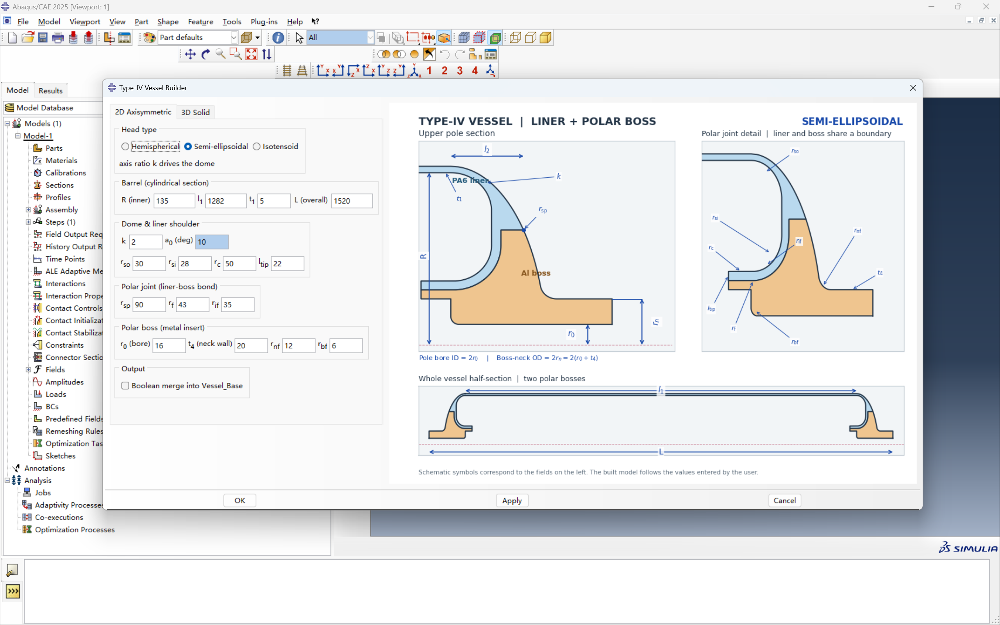
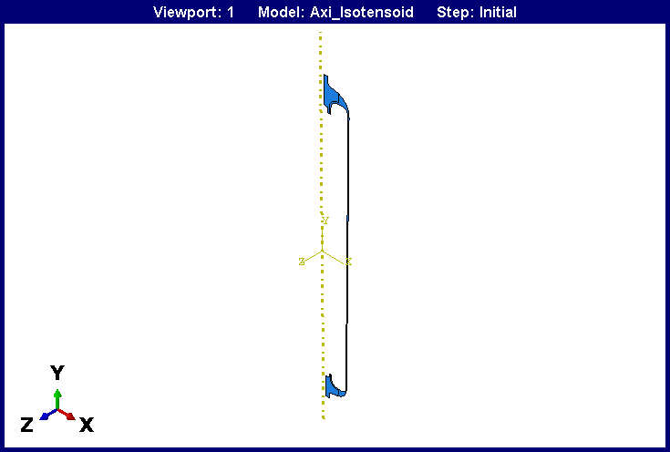
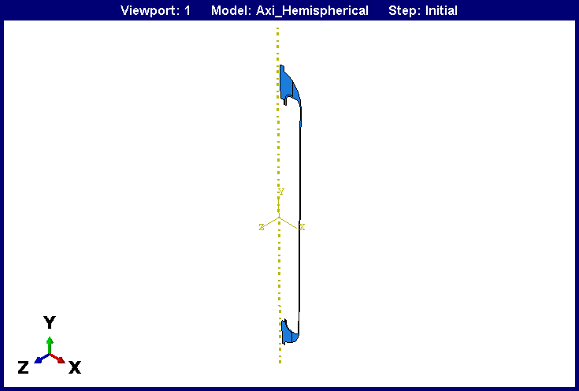
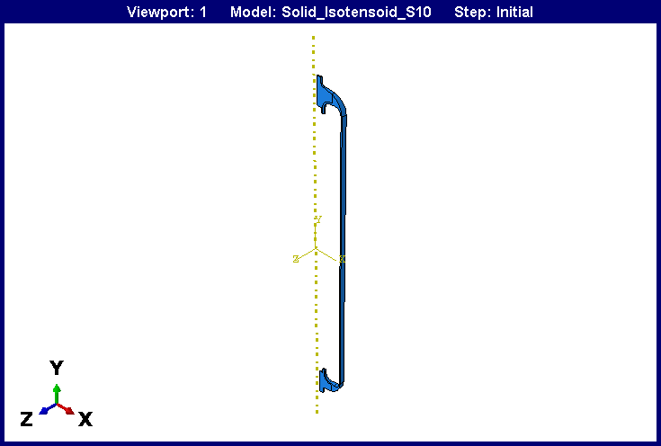
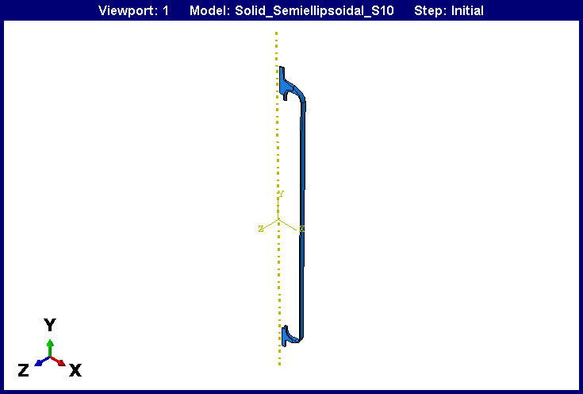

# Type-IV Vessel Builder (Liner & Boss) V1.0

[简体中文](README.zh-CN.md) | **English**

> **Status: code and installation package temporarily withdrawn.** Some features are being updated and will be fully released later. For early access or collaboration, contact **Z25150070@s.upc.edu.cn**.

> **Note on development**: This software was built with the assistance of vibe coding (AI-assisted programming).
>
> **Feedback**: If you run into any problem, feel free to open a [GitHub Issue](https://github.com/IY724/Type-IV-Vessel-Builder/issues) or contact **Z25150070@s.upc.edu.cn**.

## 1 Introduction

Type-IV Vessel Builder (Liner & Boss) V1.0 is a parametric geometry-modelling plugin for Abaqus/CAE 2025 that builds the two core components of a Type IV hydrogen storage vessel: the plastic liner and the metal polar boss. Choosing the modelling space and head type in the GUI and filling in geometric dimensions is enough — the plugin validates the parameters, computes the head profile analytically or numerically, and constructs the revolved geometry in the current CAE session, with no manual sketching.

Two modelling spaces are provided. 2D Axisymmetric builds the meridian shell section directly, ideal for quick stress assessments and sizing studies. 3D Solid builds a revolved sector of any angle or the full 3D solid, for detailed local evaluation or full 3D analysis. Both tabs sit side by side in the dialog and keep their geometric parameters synchronised bidirectionally in real time.

Three head profiles are available: Hemispherical (analytically determined by the outer radius), Semi-ellipsoidal (driven by the axis ratio k) and Isotensoid (driven by the equatorial opening angle α0 with a numerically integrated geodesic trajectory, RK4). The head depth l2 at the junction radius is computed exactly by the plugin according to the head type and echoed read-only in the dialog. With Boolean merge enabled, the liner and the two bosses are unified in the assembly into a single part, Vessel_Base, while SET_LINER and SET_BOSS geometry sets preserve the internal partition boundaries.

Scope: the plugin covers parametric geometry pre-processing only. It does not create materials or sections, does not mesh, does not apply loads or boundary conditions and does not submit solver jobs; material assignment and meshing continue in Abaqus/CAE after the geometry is built.

The complete user manual is bundled in this repository: [Type-IV Vessel Builder V1.0 software design manual](Type-IV%20Vessel%20Builder%20V1.0-软件设计说明书.pdf) (PDF) and [the Word version](Type-IV%20Vessel%20Builder%20V1.0-软件设计说明书.docx).

## 2 Capabilities

Generates the liner and the polar boss of a Type IV vessel straight from geometry
parameters, in either a 2D axisymmetric or a 3D solid modelling space, with three
head profiles.

**Parameter window**: grouped inputs on the left, linked reference drawing on the
right that follows the selected head type (layout mock-up).

<table>
<tr><td align="center" width="100%"> Semi-ellipsoidal parameter window</td></tr>
</table>

**Generated models**: Abaqus/CAE viewport.

<table>
<tr><td align="center" width="25.0%"> 2D axisymmetric, isotensoid</td><td align="center" width="25.0%"> 2D axisymmetric, hemispherical</td><td align="center" width="25.0%"> 3D solid 10 deg sector, isotensoid</td><td align="center" width="25.0%"> 3D solid 10 deg sector, semi-ellipsoidal</td></tr>
</table>

**Parameter naming and verification**

<table>
<tr><td align="center" width="50.0%"> Parameter schematic</td><td align="center" width="50.0%"> Isotensoid verification</td></tr>
</table>

**Geometry and checks**

| Item | Detail |
|---|---|
| Head profiles | Hemispherical: analytic on outer radius, no shape parameter. Semi-ellipsoidal: driven by axis ratio k. Isotensoid: equatorial opening angle alpha0 integrated numerically with a fourth-order Runge-Kutta geodesic solver |
| Head depth | l2 at the split radius is solved exactly and shown read-only, checked against boss-top height < l2 < local envelope height minus 1 mm |
| Parts | Liner is a single connected part (barrel, shoulder knuckle, head, inner envelope); Boss is two symmetric parts (valve-seat bore, neck wall, sealing ring, outer head curve) |
| Boolean merge | When enabled, the assembly merges into Vessel_Base, keeps the liner/boss interface and rebuilds SET_LINER and SET_BOSS |
| Input validation | Monotonic radius chain `0 < r0 < r_n < r_f < r_c < r_sp < R < R_out` plus a staged pipeline; any failed stage blocks the build and suggests values |
| Output and self-check | Topology self-check after creation; a JSON line prefixed `TYPE4_BUILD_OK` is printed to the message area; repeated runs increment the model-name suffix instead of overwriting |
| Units and scope | mm and deg with no hidden conversion; parametric geometry only, no materials, no meshing, no job submission |

## 3 Requirements and Installation

**Fastest**: download `Type-IV-Vessel-Builder-V1.0.zip` from [Releases](https://github.com/IY724/Type-IV-Vessel-Builder/releases/latest), unzip and place the folder as in step 2 below.
Requirements: Abaqus/CAE 2025. The plugin relies entirely on the standard Python environment embedded in Abaqus — no third-party interpreter or extra packages are required, and no Abaqus configuration files are modified.

Installation:

1. Close every Abaqus/CAE window;
2. Copy the whole `type4_vessel_builder` folder into the Abaqus plug-in directory, keeping the single-level folder structure intact (the three Python modules and the static head reference images must all sit directly in that folder);
3. Restart Abaqus/CAE and click `Type-IV Vessel Builder` under the Plug-ins menu (available in the Part, Property, Assembly and Mesh modules).

Troubleshooting: if the menu entry does not appear, the usual causes are a wrong plug-in search path, a broken folder hierarchy or a same-named backup causing module conflicts; load diagnostics are written to `type4_load.log` and `type4_gui_load.log` inside the plug-in folder.

## 4 Interface and Modelling Spaces

The dialog uses a left/right layout: the left side holds the 2D Axisymmetric and 3D Solid tabs (Head type selector and parameter groups); the right side shows the head definition reference image that switches with the head type. Apply, OK and Cancel buttons are always at the bottom.

- **2D Axisymmetric**: builds the meridian shell section (deformable, axisymmetric body); the liner is one continuous face and the boss consists of one symmetrical section at each end;
- **3D Solid**: activates the Sector angle field (0°–360°) and revolves the meridian sketch into a sector or a full solid (360° for the complete vessel);
- **Bidirectional synchronisation**: parameter edits in one tab are automatically mirrored in the other; switching tabs also switches the modelling space accordingly;
- **Boolean merge**: with `Boolean merge into Vessel_Base` enabled, the liner and bosses are instantiated and unified in the assembly with the liner–boss interfaces preserved as internal features; the merged part automatically rebuilds the SET_LINER and SET_BOSS sets.

Units: lengths in mm, angles in deg (Abaqus has no built-in unit system and the plugin performs no hidden conversions).

## 5 Geometry Parameters

| Group | Parameter | Default (mm) | Meaning |
| --- | --- | --- | --- |
| Head shape | k | 2 | Semi-ellipsoidal only: axis ratio (k>0, typically 1.5–3.0) |
| Head shape | α0 | 10 | Isotensoid only: equatorial opening angle (0°<α0<54.74°, typically 8°–15°) |
| Head shape | — | — | Hemispherical needs no shape parameter |
| Barrel | R | 135 | Liner inner radius, must exceed r_sp; outer radius R_out = R + t1 is derived |
| Barrel | l1 | 1282 | Straight cylindrical section length |
| Barrel | t1 | 5 | Liner wall thickness in the barrel |
| Barrel | L | 1520 | Overall length between the outer end faces of the two bosses (1600 recommended for hemispherical heads; auto-linked when switching) |
| Shoulder | r_so / r_si | 30 / 28 | Outer / inner shoulder fillet radii, must satisfy r_si < r_so |
| Shoulder | r_c | 50 | Liner fold-back fillet radius, must satisfy r_f < r_c < r_sp |
| Shoulder | l_tip | 22 | Axial offset of the ring end face relative to the tangent point |
| Joint | r_sp | 90 | Junction radius between the dome and the boss, must satisfy r_c < r_sp < R |
| Joint | r_f | 43 | Liner–boss bonding step radius |
| Joint | r_if | 35 | Interface fillet radius |
| Boss | r0 | 16 | Central through-bore radius (actual bore diameter is 2r0) |
| Boss | t4 | 20 | Boss neck wall thickness; neck outer radius r_n = r0 + t4 is derived |
| Boss | r_nf | 12 | Neck-to-dome transition fillet radius (keeps at least 3 mm of straight neck) |
| Boss | r_bf | 6 | Bottom chamfer radius of the bore, must be less than t4 |
| Output | Sector angle | 10° | 3D only: revolution angle, 360° for the full body |
| Output | Boolean merge | off | Whether to merge into Vessel_Base |

Monotonic radius chain and derived quantities: the kernel enforces `0 < r0 < r_n < r_f < r_c < r_sp < R < R_out`. The head depth l2 must fall inside the physical window (no less than the boss top height, no more than the local envelope height H＝(L−l1)/2 minus 1 mm, with H≥10 mm).

## 6 Validation and Outputs

Before calling the modelling operators the plugin runs a strict parameter pipeline; any failing level is intercepted safely with a clear message. The checks are:

1. R, l1, t1, L and Sector angle are positive;
2. monotonic radius chain 0 < r0 < r_n < r_f < r_c < r_sp < R < R_out;
3. shoulder straight-section margin and fillet relation (r_si < r_so and R − r_so − r_c − r_si > 0);
4. l_tip offset bound l_tip > −(r_so − r_si);
5. bottom chamfer bound r_bf < t4;
6. end-face local height H ≥ 10 mm;
7. isotensoid limit 0 < α0 < 54.74° with a compatible trajectory constant r_cl;
8. head depth window: boss top height < l2 < H − 1 mm;
9. neck fillet tangency (bisection) succeeds with at least 3 mm of straight neck.

Outputs:

- 2D creates a model named `TypeIV_Vessel_Axi`; 3D creates `TypeIV_Vessel` (an index suffix is appended when the name exists);
- without merge, the liner and boss parts are created as independent parts (with SET_LINER / SET_BOSS sets); with merge, the combined Vessel_Base part is additionally created;
- every part is checked with a high-level geometric topology self-check after creation;
- a JSON summary prefixed with `TYPE4_BUILD_OK` (part volumes and section areas) is printed to the CAE message area;
- the plugin never auto-saves the CAE database — save manually via File → Save / Save As.

## 7 Plugin Files

| File | Responsibility |
| --- | --- |
| type4_plugin.py | Registers the main menu button and action listeners in the Abaqus GUI environment |
| type4_builder_db.py | Builds the two-tab dialog on AFXForm / AFXDataDialog, handles widget linkage and keyword collection |
| type4_builder_kernel.py | Core geometry kernel: parameter validation, analytic and numerically integrated meridian segments, revolve construction |

## 8 FAQ

- **Menu entry missing**: make sure the whole `type4_vessel_builder` folder is in the plug-in directory and remove any leftover copies, then restart CAE;
- **Total length switches to 1600 mm in hemispherical mode**: this is the built-in anti-interference protection, expected behaviour;
- **k or α0 cannot be typed**: the field is disabled for the current head type — switch the head type first;
- **No assembly instance in the model tree**: without Boolean merge only standalone parts are created; create instances in the Assembly module;
- **Model lost after closing**: the plugin does not auto-save; use the File menu to save the CAE database.

## 9 Usage and Contact

- Non-commercial use is allowed. Features are being upgraded; contact **Z25150070@s.upc.edu.cn** for early access.
- Feedback: open a [GitHub Issue](https://github.com/IY724/Type-IV-Vessel-Builder/issues) or contact **Z25150070@s.upc.edu.cn**.
